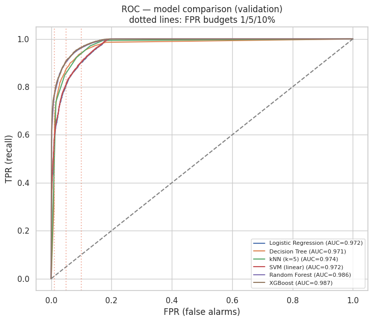
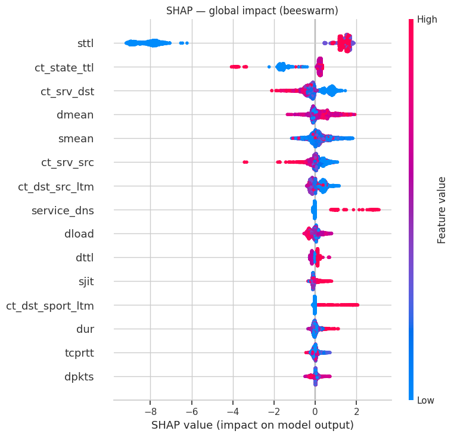

# ML-Based Network Intrusion Detection on UNSW-NB15

**A strictly validated XGBoost intrusion detector, with SHAP explanations and a SOC-style analyst console.**

Master's thesis project (Master SDIA, Data Science & AI, ENSET Mohammedia), defended 27 September 2026.
Author: **Brahim EL HANATI** · Supervisor: Pr. Mohammed Mestari


---

## Why this project

Security Operations Centres drown in alerts, and ML is often proposed to separate malicious flows from legitimate ones. A lot of published IDS work reports inflated numbers because the test set is consulted during model selection and threshold tuning, and because duplicate records stay in the training data.

This project builds a network IDS under a **deliberately strict protocol** and reports what happens when you do it honestly, including where the model breaks.

## Key results

| | Validation | Sealed test (single evaluation, 95% bootstrap CI) |
|---|---|---|
| ROC-AUC | 0.9879 | **0.9840** [0.9834, 0.9846] |
| Recall | 0.912 | **0.9729** [0.9713, 0.9745] |
| False positive rate | 0.0495 | **0.1961** [0.1919, 0.1999] |
| Precision | 0.946 | 0.8588 [0.8557, 0.8618] |
| F1 | — | 0.9123 [0.9105, 0.9142] |

Decision threshold **t = 0.630**, chosen on validation to *maximise recall subject to FPR ≤ 5%*.

**Main findings**

1. **XGBoost wins at matched operating points**, not just on aggregate ROC-AUC (recall 0.909 at FPR ≤ 5% vs 0.903 for Random Forest), and it is fast at inference: 8.7 µs/flow, against 845 µs/flow for kNN.
2. **The FPR budget does not survive the sealed test.** A threshold calibrated for a 5% FPR delivers 19.6% on test, four times the budget. This is consistent with a measured distribution shift between the official partitions: median `sttl` of normal flows doubles from 31 to 62. Part of the gap may also come from refitting the final model on the full training set, so shift is treated as a plausible contributing factor rather than a proven sole cause.
3. **`sttl` is not a shortcut the model depends on.** Removing it costs −0.0001 ROC-AUC. Removing the whole `ct_*` family does hurt (recall at 5% FPR drops from 0.912 to 0.862), which shows the ablation can detect a real dependency.
4. **Base rates matter.** At a realistic attack prevalence of 0.1%, the test precision would fall to about 0.5%. A detector like this belongs behind a pre-filter and in front of a triage queue, not alone at the perimeter.

## Method

```
UNSW-NB15 official train ──► inner train ──► fit preprocessing + models, hyperparameter search (3-fold CV)
                         └─► validation  ──► every decision: model choice, imbalance, threshold, calibration
UNSW-NB15 official test  ──► sealed until one final evaluation (bootstrap CIs)
```

- **Leakage control.** Preprocessing parameters are learned on train only. Identifiers are dropped *before* deduplication, which exposes 42.4% of the training partition as duplicates (175,341 → 101,040 rows). Train/test overlap (10.4% of test flows) is measured and reported separately.
- **Pipeline.** Cleaning, a `ColumnTransformer` (robust scaling, log1p clipping, one-hot encoding with rare-category grouping) and the classifier are fitted together and saved as **one joblib bundle**, with the threshold and its provenance stored inside.
- **Models compared.** Dummy baseline, Logistic Regression, Decision Tree, Random Forest, linear SVM, kNN and XGBoost. They are compared at threshold 0.50 and at FPR budgets of 1%, 5% and 10%.
- **Tuned XGBoost.** `n_estimators=544, max_depth=9, learning_rate=0.0595, subsample=0.909, colsample_bytree=0.817, reg_lambda=4.94`.
- **Analysis.** Calibration (isotonic brings no gain, so the output is reported as a score, not a probability), SHAP and permutation importance, ablation, and error analysis by attack category, protocol, service and connection state.
- **Multiclass stage.** A hierarchical second stage classifies the attack family. Class weighting raises balanced accuracy from 0.695 to 0.797.

<p align="center">
  
  
</p>

### Detection by attack category (sealed test)

| Category | Recall | | Category | Recall |
|---|---|---|---|---|
| Generic | 1.000 | | Shellcode | 0.984 |
| Worms | 1.000 | | Analysis | 0.979 |
| Backdoor | 0.998 | | **Fuzzers** | **0.820** |
| DoS / Reconnaissance | 0.997 | | Exploits | 0.992 |

Fuzzers are the hardest family. They also make up most of the "grey zone" of flows that score close to the threshold, which makes them the natural candidates for an analyst review queue.

## SOC analyst console

`app/soc_console.py` is a Streamlit application that **replays the sealed test partition as live traffic**. Flows stream in, the production pipeline scores each one, alerts fire above the threshold, and every alert shows its **top-8 signed SHAP contributions**. After about 5,000 replayed flows, the running indicators match the sealed-test values to within a fraction of a point (detection 97.5%, FPR 19.8%).

<!-- Add a screenshot: docs/figures/console.png -->

## Repository structure

```
├── notebooks/
│   └── IDS_ML_Project.ipynb   # full analysis, sections 0–19, outputs included
├── app/
│   └── soc_console.py         # Streamlit SOC replay console
├── models/                    # put ids_xgb_bundle.joblib here (see models/README.md)
├── data/                      # put the UNSW-NB15 CSVs here (see data/README.md)
├── docs/figures/              # figures exported from the notebook
└── requirements.txt
```

## Getting started

### 1. Get the data

Download `UNSW_NB15_training-set.csv` and `UNSW_NB15_testing-set.csv` from the [official UNSW-NB15 page](https://research.unsw.edu.au/projects/unsw-nb15-dataset) and place them in `data/`. The dataset is not redistributed here.

### 2. Run the notebook

The notebook was built on **Google Colab** (CPU runtime) with the data in Google Drive at `/content/drive/MyDrive/data/`.

- For a quick check, set `RUN_TUNING`, `RUN_MULTICLASS` and `DASHBOARD` to `False`.
- For a full run, use *Run all* from a fresh session. It takes about 15 minutes, including 6 minutes of hyperparameter search.
- **Section 15 is the only cell that touches the test set.**
- All seeds are fixed at 42. Two independent runs produced identical results.

### 3. Run the console locally

```bash
pip install -r requirements.txt
streamlit run app/soc_console.py
```

Paths default to `models/ids_xgb_bundle.joblib` and `data/UNSW_NB15_testing-set.csv`. You can override them:

```bash
IDS_BUNDLE_PATH=/path/to/bundle.joblib IDS_TEST_CSV=/path/to/test.csv streamlit run app/soc_console.py
```

> **Note.** The bundle pickles a named function `log1p_clip`. The console registers it in `__main__` before loading, otherwise unpickling fails. Load the bundle with the same scikit-learn / XGBoost versions that were used to save it.

## Limitations

- UNSW-NB15 is a synthetic testbed with roughly 55% attacks, which is far from real traffic.
- The validation-to-test FPR gap is not fully explained. Dataset shift and the score shift caused by refitting are confounded.
- There is no live packet capture: the console replays recorded flows.
- False alarms concentrate on `state=INT` and `service=ftp`. Per-segment thresholds or an upstream rule are possible next steps, but neither is implemented.

## Thesis

*Design and Implementation of a Machine Learning-Based Intrusion Detection System for Network Security*. Master SDIA, ENSET Mohammedia, Université Hassan II de Casablanca, 2026.

## License

Code released under the MIT License. UNSW-NB15 is © UNSW Canberra and subject to its own terms.

## Contact

Brahim EL HANATI · [LinkedIn](https://www.linkedin.com/in/brahim-el-hanati) · elhanatibrahim@gmail.com
